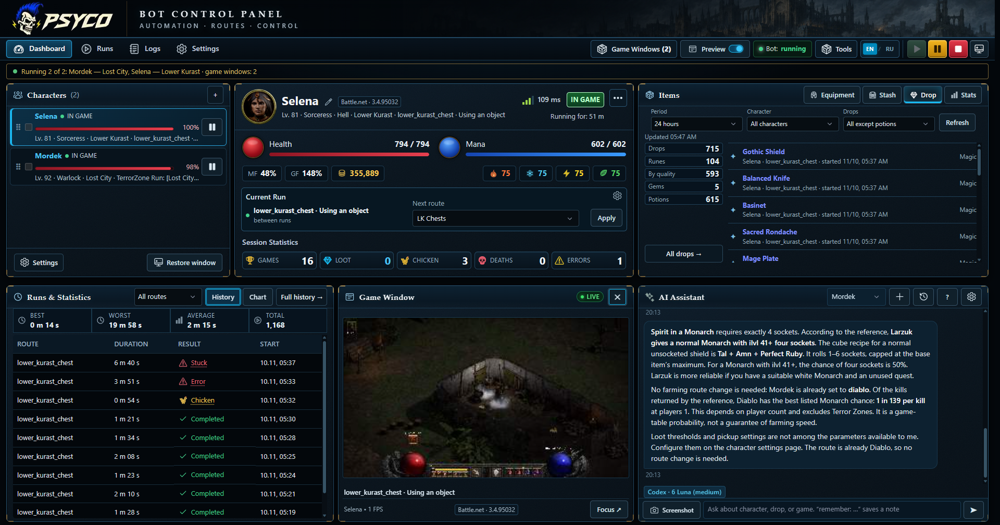
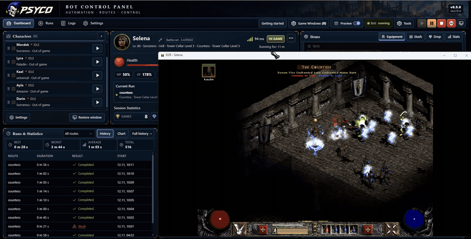
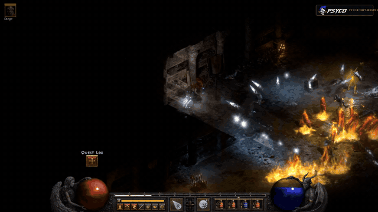
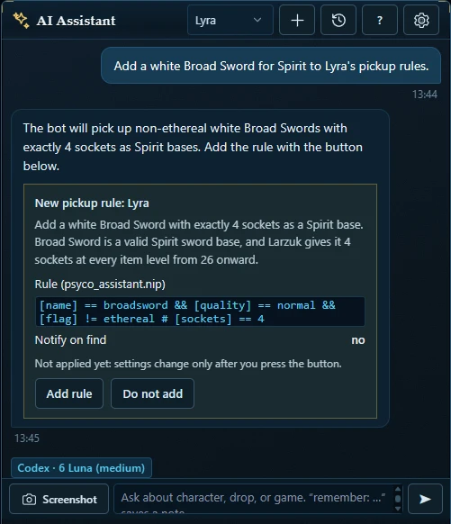
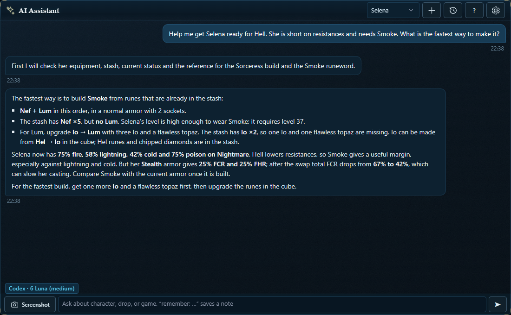

<h1 align="center">PSYCO: Diablo II Resurrected farming bot</h1>

<b>Less setup. More farming.</b> 
A D2R farming and leveling bot for Windows with one control panel for all your characters and a free AI assistant that helps you set it up.

<a href="https://psyco-bot.online/"><b>Website</b></a> ·
<a href="https://discord.gg/sBNBF843C5"><b>Free trial in Discord</b></a> ·
<a href="#features">Features</a> ·
<a href="#psyco-ai-assistant">AI assistant</a> ·
<a href="#faq">FAQ</a> ·
<a href="https://www.youtube.com/@psyco-bot">YouTube</a> ·
<a href="README.ru.md">Русский</a>

## What is PSYCO?

PSYCO farms and levels your characters in **Diablo II: Resurrected**. Characters, routes, pickup rules and game windows are all managed from one control panel.

**Windows 10 / 11, 64-bit** · **Battle.net and Steam** · **All 8 classes** · **As many game windows as your PC can run**

### A real farming run

Not just the interface: a short capture from a Hell Sorceress run against the Countess, showing Safe Mode during the fight and the boss-defeated result.

## Set up in minutes

Tell the AI assistant what you want in plain words. It reads your character and the game reference and answers with a card: new settings, a route or a pickup rule. Nothing changes until you press the button on the card. You can also set everything up yourself in the **Installation Wizard**.

## Features

| | |
|---|---|
| **Farming routes** | Boss runs, level 85 areas, the Cow Level and Terror Zones, chosen per character. |
| **Universal farmer** | Works with all eight classes: put combat skills on the main slots and pick a route. |
| **Auto-leveling** | Runs the quests and spends skill and stat points. |
| **Runewords** | The bot crafts runewords itself and can reroll them until they get the stats you set. A planner shows what your runes can make. |
| **Horadric Cube** | 69 recipes: rune and gem upgrades, sockets, Grand Charm rerolls and crafted items. |
| **Pickit Editor** | Visual editor: pick an item and its conditions, and PSYCO writes the NIP rule. |
| **Armory** | Gear, inventory and stash of every character on one screen, with search. |
| **Run and drop history** | Every drop, run, chicken and death is saved. |
| **Survival** | Potions for hero and mercenary, Chicken at low life and on dangerous curses and auras. |
| **Safe mode** | Increased safety mode: in boss fights a Sorceress teleports away from danger and waits to heal. |
| **Scheduler** | Work hours, session length and breaks with random variation. |
| **Muling and item transfers** | A full shared stash goes to your mules; any item can be dropped in a game you name. |
| **Inventory locking** | Slots with charms, tomes and the Cube stay untouched. |
| **No-HD support** | Saves about 2 GB of RAM per game window. |
| **Discord** | Drop and status notifications, plus bot commands. |

## PSYCO AI assistant

Built in and free. It sees your character's gear, resistances, stash, runs and drops. Ask it to write Pickit rules, pick routes and thresholds, find upgrades, choose the next runeword or explain why runs fail. It only proposes changes; you apply them with a button.

Free models work. The bot also runs without any AI connected.

## Getting started

1. Windows 10 or 11 (64-bit), D2R on Battle.net or Steam. Run PSYCO as administrator.
2. Open the PSYCO control panel; the Installation Wizard starts on first launch.
3. Add a character, pick a build and routes, start the first run.

## FAQ

**How much does it cost?**
Free trial in [Discord](https://discord.gg/sBNBF843C5); plans and prices on the [website](https://psyco-bot.online/).

**What happens after a D2R patch?**
A patch can require a PSYCO update. Wait for a compatible release if your game version isn't supported yet.

**Is there a risk to my account?**
Yes. Botting breaks the game's terms, so you use PSYCO at your own risk.

## Community

Guides, updates and answers are in Discord, on YouTube and on the website.

- Website: [psyco-bot.online](https://psyco-bot.online/)
- Discord: [discord.gg/sBNBF843C5](https://discord.gg/sBNBF843C5)
- YouTube: [@psyco-bot](https://www.youtube.com/@psyco-bot)

---

PSYCO is an independent project, not affiliated with or endorsed by Blizzard Entertainment. Diablo II: Resurrected is a trademark of its owner.
