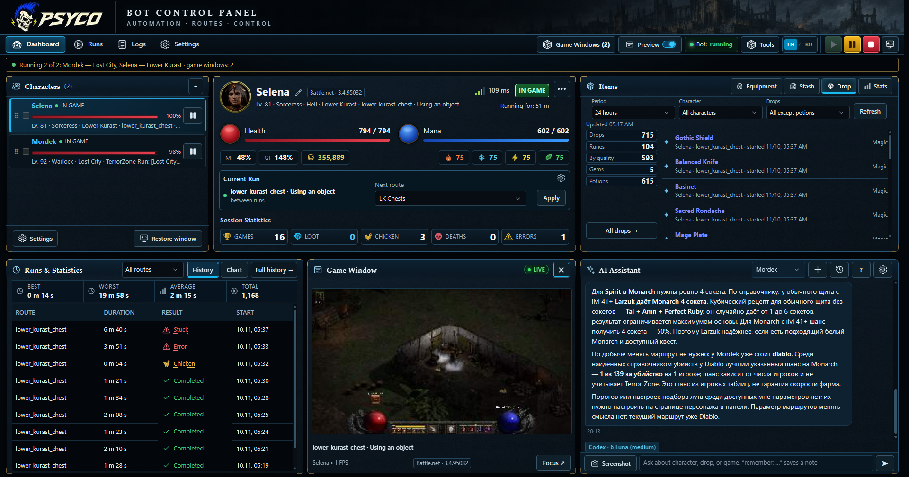
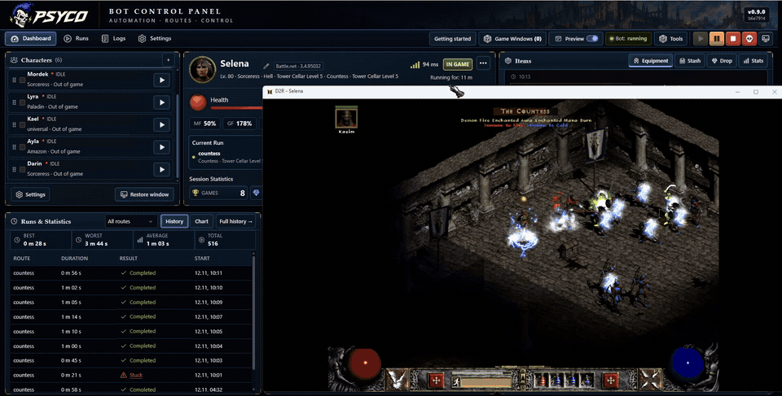
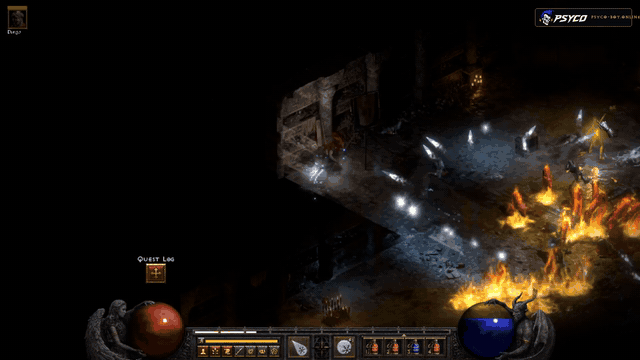
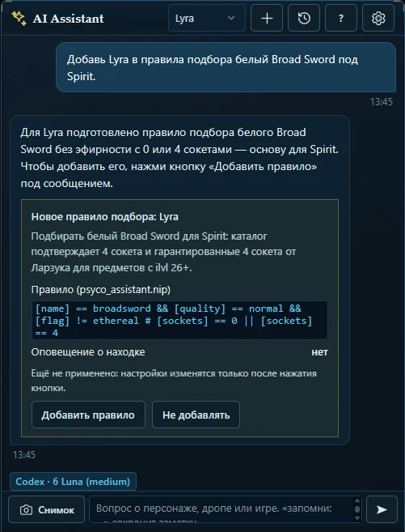
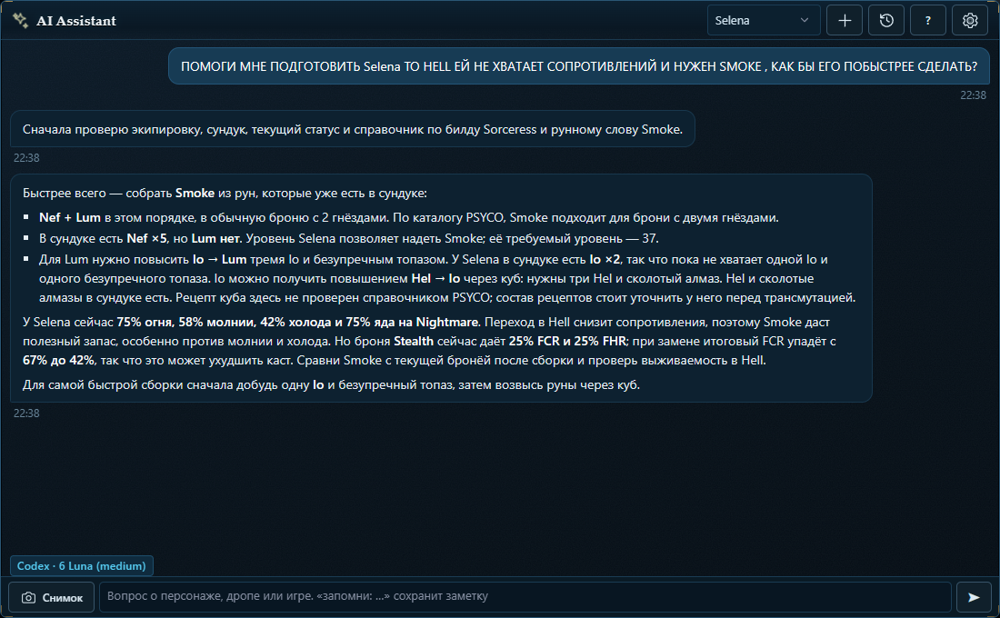

<h1 align="center">PSYCO: бот для фарма в Diablo II Resurrected</h1>

<b>Меньше настройки. Больше фарма.</b> 
Бот для фарма и прокачки в D2R под Windows: одна панель управления для всех персонажей и бесплатный AI-помощник, который помогает всё настроить.

<a href="https://psyco-bot.online/ru/"><b>Сайт</b></a> ·
<a href="https://discord.gg/sBNBF843C5"><b>Бесплатный пробный период в Discord</b></a> ·
<a href="#возможности">Возможности</a> ·
<a href="#psyco-ai-помощник">AI-помощник</a> ·
<a href="#частые-вопросы">Вопросы</a> ·
<a href="https://www.youtube.com/@psyco-bot">YouTube</a> ·
<a href="README.md">English</a>

## Что такое PSYCO?

PSYCO фармит и качает ваших персонажей в **Diablo II: Resurrected**. Персонажи, маршруты, правила подбора и игровые окна управляются из одной панели.

**Windows 10 / 11, 64 бита** · **Battle.net и Steam** · **Все 8 классов** · **Столько игровых окон, сколько потянет компьютер**

### Пример реального забега

Не только интерфейс: короткий фрагмент HELL-забега Волшебницы против Графини. Видно, как работает Safe Mode, и чем заканчивается бой.

## Настройка за несколько минут

Напишите AI-помощнику своими словами, что нужно. Он посмотрит персонажа и справочник игры и ответит карточкой: новые настройки, маршрут или правило подбора. Ничего не меняется, пока вы не нажмёте кнопку на карточке. Можно настроить всё и самому в **Мастере установки**.

## Возможности

| | |
|---|---|
| **Маршруты фарма** | Боссы, зоны 85 уровня, Коровник и Зоны Ужаса, отдельно для каждого персонажа. |
| **Универсальный фармер** | Работает со всеми восемью классами: поставьте боевые навыки на основные слоты и выберите маршрут. |
| **Автопрокачка** | Проходит квесты и распределяет очки навыков и характеристик. |
| **Рунные слова** | Бот сам собирает рунные слова и может перекатывать их до нужных свойств. Планировщик показывает, что собирается из ваших рун. |
| **Хорадрический куб** | 69 рецептов: улучшение рун и камней, гнёзда, перекатка больших оберегов и крафтовые вещи. |
| **Редактор Pickit** | Визуальный редактор: выберите предмет и условия, и PSYCO составит правило NIP. |
| **Арсенал** | Экипировка, инвентарь и сундуки всех персонажей на одном экране, с поиском. |
| **История забегов и находок** | Сохраняются все находки, забеги, чикены и смерти. |
| **Выживание** | Зелья для героя и наёмника, Chicken при низком здоровье и на опасных проклятиях и аурах. |
| **Safe-режим** | Режим повышенной безопасности: в боях с боссами Волшебница уходит телепортом от опасности и ждёт, пока вылечится. |
| **Расписание** | Рабочие часы, длина сессии и перерывы со случайным разбросом. |
| **Мулинг и передача предметов** | Полный общий сундук уходит мулам; любую вещь бот выбросит в игре, которую вы назовёте. |
| **Блокировка инвентаря** | Ячейки с оберегами, книгами и Кубом бот не трогает. |
| **Поддержка No-HD** | Экономит около 2 ГБ памяти на каждое окно игры. |
| **Discord** | Уведомления о находках и статусе, команды для бота. |

## PSYCO AI-помощник

Встроен и бесплатен. Видит экипировку, сопротивления, сундук, забеги и находки персонажа. Попросите его написать правила Pickit, выбрать маршруты и пороги, найти улучшения, подсказать следующее рунное слово или разобраться, почему срываются забеги. Он только предлагает изменения, применяете их вы кнопкой.

Подходят и бесплатные модели. Сам бот работает и без AI.

## Начало работы

1. Windows 10 или 11 (64 бита), D2R в Battle.net или Steam. Запускайте PSYCO от имени администратора.
2. Откройте панель управления PSYCO; при первом запуске откроется Мастер установки.
3. Добавьте персонажа, выберите билд и маршруты, запустите первый забег.

## Частые вопросы

**Сколько это стоит?**
Бесплатный пробный период в [Discord](https://discord.gg/sBNBF843C5), тарифы и цены на [сайте](https://psyco-bot.online/ru/).

**Что будет после патча D2R?**
Патч может потребовать обновления PSYCO. Если ваша версия игры ещё не поддерживается, дождитесь совместимого выпуска.

**Есть ли риск для аккаунта?**
Да. Боты запрещены правилами игры, поэтому вы используете PSYCO на свой риск.

## Сообщество

Гайды, новости и ответы на вопросы в Discord, на YouTube и на сайте.

- Сайт: [psyco-bot.online](https://psyco-bot.online/ru/)
- Discord: [discord.gg/sBNBF843C5](https://discord.gg/sBNBF843C5)
- YouTube: [@psyco-bot](https://www.youtube.com/@psyco-bot)

---

PSYCO — независимый проект, не связанный с Blizzard Entertainment и не одобренный ею. Diablo II: Resurrected — товарный знак своего владельца.
